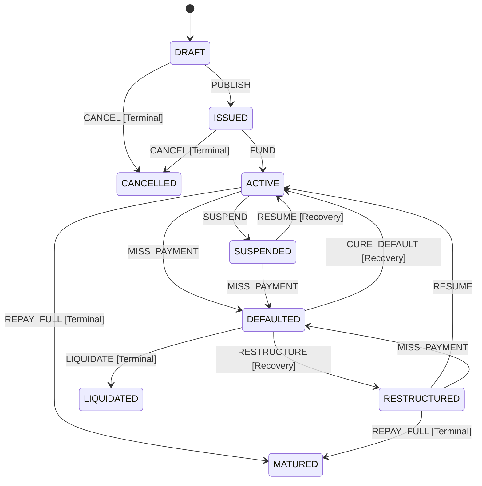
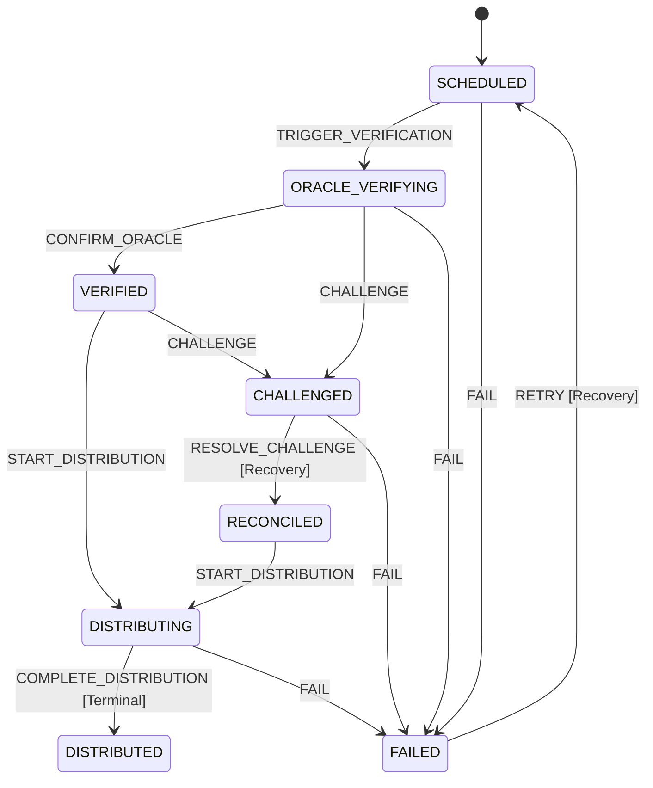
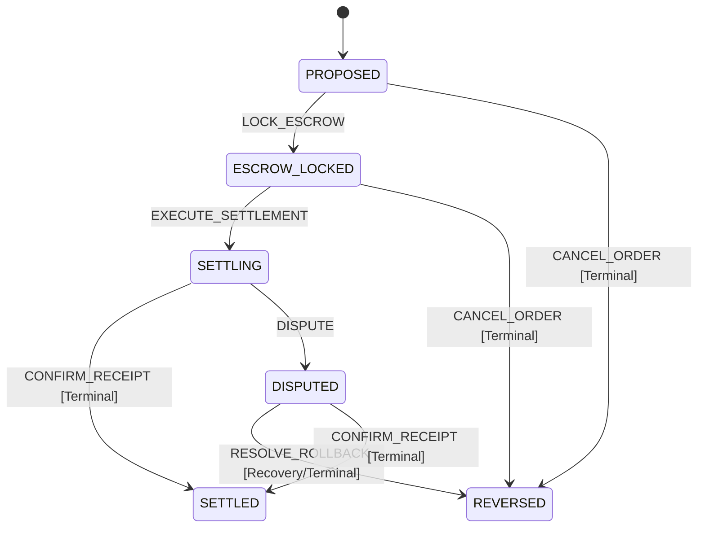

# Formal Lifecycle State Machines: Terminal and Recovery Transitions

Resolves **Issue #358**.

## Overview
The Verdant Bond Protocol implements formal lifecycle state machines governing:
1. **Green Bond Lifecycle** (`BondStateMachine`)
2. **Carbon Credit Coupon Verification & Distribution** (`CouponStateMachine`)
3. **Secondary-Market Settlement & Escrow** (`SettlementStateMachine`)

Every state transition is deterministic. Attempting an invalid or undefined transition raises an `InvalidStateTransitionException` providing complete diagnostic context (current state, event attempted, valid allowed events, and whether the current state is terminal).

---

## 1. Green Bond Lifecycle (`BondStateMachine`)



### Terminal States
- **`MATURED`:** Reached when all principal and scheduled coupons are fully repaid. Zero outgoing transitions permitted.
- **`CANCELLED`:** Reached if the bond issuance is aborted during draft or fails to reach minimum subscription threshold during auction.
- **`LIQUIDATED`:** Reached if default grace period expires without cure or restructuring; pledged carbon credits/collateral are liquidated to compensate bondholders.

### Recovery Transitions
- **`SUSPENDED` $\xrightarrow{\text{RESUME}}$ `ACTIVE`:** Triggered when temporary holds (e.g. oracle circuit breaker trips, compliance reviews) are resolved.
- **`DEFAULTED` $\xrightarrow{\text{CURE_DEFAULT}}$ `ACTIVE`:** Triggered when the issuer repays missed coupon obligations plus penalty during the grace window.
- **`DEFAULTED` $\xrightarrow{\text{RESTRUCTURE}}$ `RESTRUCTURED`:** Triggered when supermajority bondholder vote approves revised payment terms and covenants.

---

## 2. Carbon Credit Coupon Lifecycle (`CouponStateMachine`)



### Recovery Transitions
- **`CHALLENGED` $\xrightarrow{\text{RESOLVE_CHALLENGE}}$ `RECONCILED`:** Resolves oracle measurement challenges via secondary satellite/IoT verification.
- **`FAILED` $\xrightarrow{\text{RETRY}}$ `SCHEDULED`:** Recovers transient network or contract dispatch failures for idempotent re-execution.

---

## 3. Secondary-Market Settlement Lifecycle (`SettlementStateMachine`)



### Recovery Transitions
- **`DISPUTED` $\xrightarrow{\text{RESOLVE_ROLLBACK}}$ `REVERSED`:** When on-chain settlement anomalies or fraudulent delivery occur, funds and tokenized bond units held in escrow are atomically returned to their respective original owners.

---

## 4. Deterministic Error Diagnostics

When an unpermitted transition occurs:
```typescript
throw new InvalidStateTransitionException(
  currentState, // e.g., 'LIQUIDATED'
  event,        // e.g., 'RESUME'
  allowedEvents,// e.g., []
  isTerminal,   // true
);
```
Output message:
`Invalid state transition from LIQUIDATED via event RESUME. State is terminal. No outgoing transitions permitted.`
This eliminates ambiguous state drift and guarantees strict state-machine conformance.
